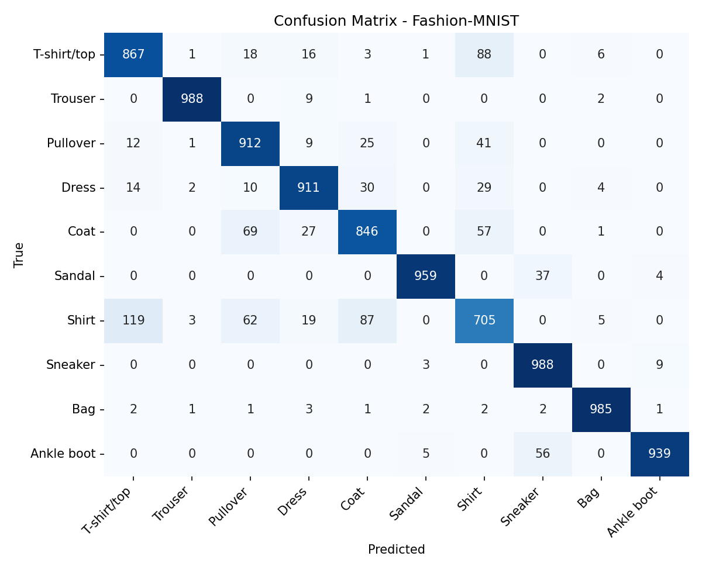

# Fashion-MNIST CNN Classifier

A convolutional neural network built with TensorFlow/Keras to classify images from the [Fashion-MNIST](https://github.com/zalandoresearch/fashion-mnist) dataset (70,000 grayscale 28x28 images across 10 clothing categories).

## Features

- 3 convolutional blocks with Batch Normalization and Dropout
- Data augmentation (random horizontal flip and translation)
- Early stopping and learning-rate scheduling
- Automatic saving of plots and metrics to `results/`
- Model export in the native `.keras` format

## Dataset

Fashion-MNIST is downloaded automatically by Keras the first time you run the script, so there is no need to add it to the repository.

| Label | Class |
|-------|-------------|
| 0 | T-shirt/top |
| 1 | Trouser |
| 2 | Pullover |
| 3 | Dress |
| 4 | Coat |
| 5 | Sandal |
| 6 | Shirt |
| 7 | Sneaker |
| 8 | Bag |
| 9 | Ankle boot |

## Model Architecture

```
Input (28x28x1)
 -> RandomFlip + RandomTranslation (training only)
 -> [Conv2D -> BatchNorm -> ReLU -> MaxPool -> Dropout(0.25)] x 3  (32, 64, 128 filters)
 -> Flatten
 -> Dense(128, ReLU) -> Dropout(0.4)
 -> Dense(10, Softmax)
```

## Installation

```bash
git clone https://github.com/<your-username>/fashion-mnist-cnn.git
cd fashion-mnist-cnn

python -m venv .venv
source .venv/bin/activate        # On Windows: .venv\Scripts\activate
pip install -r requirements.txt
```

## Usage

```bash
python train.py
```

The script will:

1. Download and preprocess the dataset
2. Train the model (up to 30 epochs with early stopping)
3. Evaluate it on the test set
4. Save the plots, the classification report, and the trained model

## Results

After training, the following files are generated in `results/`:

| File | Description |
|------|-------------|
| `samples.png` | Sample training images |
| `training_curves.png` | Accuracy and loss curves |
| `confusion_matrix.png` | Confusion matrix on the test set |
| `sample_predictions.png` | 16 random test predictions |
| `classification_report.txt` | Precision, recall, and F1 per class |

**Test accuracy:** `XX.XX%` <!-- replace with your result -->



## Project Structure

```
fashion-mnist-cnn/
├── train.py
├── requirements.txt
├── README.md
├── .gitignore
└── results/
```

## Requirements

- Python 3.9+
- TensorFlow 2.15+
- NumPy, Matplotlib, Seaborn, scikit-learn

