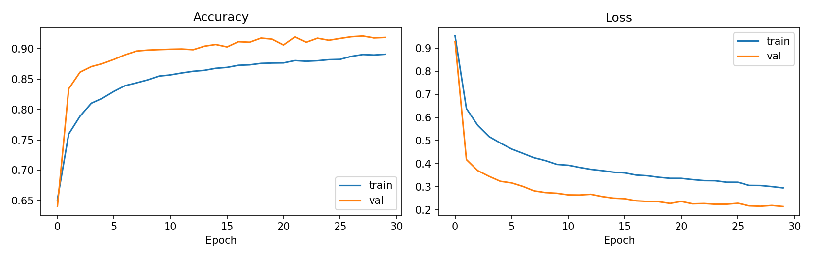
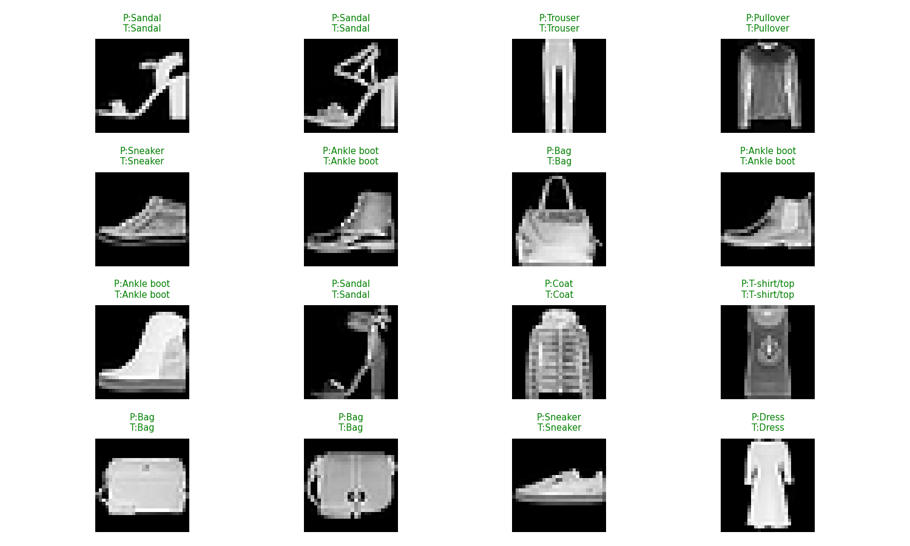

# Fashion-MNIST CNN Classifier

A convolutional neural network built with TensorFlow/Keras to classify images from the [Fashion-MNIST](https://github.com/zalandoresearch/fashion-mnist) dataset (70,000 grayscale 28x28 images across 10 clothing categories).

## Features

- 3 convolutional blocks with Batch Normalization and Dropout
- Data augmentation (random horizontal flip and translation)
- Early stopping and learning-rate scheduling
- Automatic saving of plots and metrics to `results/`
- Model export in the native `.keras` format

## Dataset

Fashion-MNIST is downloaded automatically by Keras the first time you run the code, so there is no need to add it to the repository.

| Label | Class |
|-------|-------------|
| 0 | T-shirt/top |
| 1 | Trouser |
| 2 | Pullover |
| 3 | Dress |
| 4 | Coat |
| 5 | Sandal |
| 6 | Shirt |
| 7 | Sneaker |
| 8 | Bag |
| 9 | Ankle boot |

The training data is split into 55,000 images for training and 5,000 for validation. The 10,000 test images are used only for the final evaluation.

## Model Architecture

```
Input (28x28x1)
 -> RandomFlip + RandomTranslation (training only)
 -> [Conv2D -> BatchNorm -> ReLU -> MaxPool -> Dropout(0.25)] x 3  (32, 64, 128 filters)
 -> Flatten
 -> Dense(128, ReLU) -> Dropout(0.4)
 -> Dense(10, Softmax)
```

Total parameters: 242,218 (241,770 trainable).

## Installation

```bash
git clone https://github.com/Habiba-elgamal158/fashion-mnist-cnn.git
cd fashion-mnist-cnn

python -m venv .venv
source .venv/bin/activate        # On Windows: .venv\Scripts\activate
pip install -r requirements.txt
```

## Usage

**Option 1: Python script**

```bash
python train.py
```

**Option 2: Notebook**

Open `fashion_mnist_cnn.ipynb` in Jupyter or Google Colab and run all cells. Enabling a GPU runtime in Colab (Runtime > Change runtime type) makes training much faster.

Either way, the code will:

1. Download and preprocess the dataset
2. Train the model (up to 30 epochs with early stopping)
3. Evaluate it on the test set
4. Save the plots, the classification report, and the trained model

## Results

**Test accuracy: 91.00%**

### Per-class performance

| Class | Precision | Recall | F1-score |
|-------|-----------|--------|----------|
| T-shirt/top | 0.86 | 0.87 | 0.86 |
| Trouser | 0.99 | 0.99 | 0.99 |
| Pullover | 0.85 | 0.91 | 0.88 |
| Dress | 0.92 | 0.91 | 0.91 |
| Coat | 0.85 | 0.85 | 0.85 |
| Sandal | 0.99 | 0.96 | 0.97 |
| Shirt | 0.76 | 0.70 | 0.73 |
| Sneaker | 0.91 | 0.99 | 0.95 |
| Bag | 0.98 | 0.98 | 0.98 |
| Ankle boot | 0.99 | 0.94 | 0.96 |

The model performs best on Trouser, Bag, and Sandal, and struggles most with Shirt, which is visually similar to T-shirt/top, Pullover, and Coat.

### Training curves



### Confusion matrix


### Sample predictions



## Project Structure

```
fashion-mnist-cnn/
├── fashion_mnist_cnn.ipynb
├── train.py
├── requirements.txt
├── README.md
├── .gitignore
└── results/
    ├── training_curves.png
    ├── confusion_matrix.png
    ├── sample_predictions.png
    └── classification_report.txt
```

## Requirements

- Python 3.9+
- TensorFlow 2.15+
- NumPy, Matplotlib, Seaborn, scikit-learn

## Possible Improvements

- Tune the augmentation strength and dropout rates (the model is slightly regularized)
- Try deeper architectures or residual connections
- Add more targeted handling for the Shirt class, which has the lowest F1-score

## Author

Habiba Elgamal - [GitHub](https://github.com/Habiba-elgamal158)
